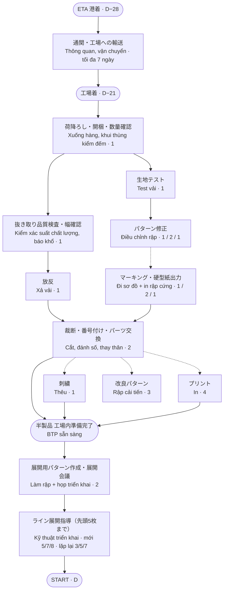

# Lead time sản xuất: từ ETA đến START / 生産工程リードタイム

Tài liệu dùng để thảo luận với TIJ về mốc giao nguyên phụ liệu.

| | ETA (về cảng HCM / 港着) | 工場着 (về nhà máy) |
|---|---|---|
| **Chuẩn cũ / 旧基準** | START − 21 ngày (3 tuần) | START − 14 ngày (2 tuần) |
| **Chuẩn mới / 新基準** | START − 28 ngày (4 tuần) | START − 21 ngày (3 tuần) |

- START = ngày chuyền ra 5 pcs đầu sau khi triển khai, bắt đầu sản xuất hàng loạt (mốc "Ra chuyền" trong file rà soát).
- Từ ETA đến 工場着: thông quan + vận chuyển, tối đa 7 ngày kể cả luồng đỏ.

## Flowchart / 業務フロー

Nét đứt: bắt đầu cùng lúc / làm song song. Số ngày theo 3 mức SAH: dưới 8.000 / 8.000–12.000 / trên 12.000 giây.

## Thời gian chuẩn (ngày làm việc)

Nguồn: `data/nguon/Ra-soat-thoi-gian-can-de-vao-chuyen-20260722.xlsx`.

| Bộ phận | Bước | < 8.000s | 8.000–12.000s | > 12.000s | Người |
|---|---|---|---|---|---|
| XNK & Vận chuyển | Khai nhận, chuyển hàng về nhà máy (ngày lịch) | 7 | 7 | 7 | ? |
| Bốc vác | Xuống hàng, khui thùng kiểm đếm | 1 | 1 | 1 | ? |
| Chất lượng kho | Kiểm xác suất chất lượng, báo khổ | 1 | 1 | 1 | 1 |
| Kỹ thuật | Test vải | 1 | 1 | 1 | 1 |
| Phòng cắt | Xả vải | 1 | 1 | 1 | 1 |
| Kỹ thuật | Điều chỉnh rập theo kết quả test vải | 1 | 2 | 1 | 1 |
| Kỹ thuật | Đi sơ đồ + in rập cứng | 1 | 2 | 1 | 2 |
| Kỹ thuật | Rập cải tiến | 3 | 3 | 3 | 1 |
| Phòng cắt | Cắt, đánh số, thay thân | 2 | 2 | 2 | 1 |
| Gia công | Thêu | 1 | 1 | 1 | ? |
| Gia công | In | 4 | 4 | 4 | ? |
| Chuyền | Làm rập triển khai + họp triển khai | 2 | 2 | 2 | ? |
| Chuyền | Kỹ thuật triển khai – mã mới | 5 | 7 | 8 | 1 |
| Chuyền | Kỹ thuật triển khai – hàng lặp lại | 3 | 5 | 7 | 1 |

## Số ngày cần từ 工場着 đến START

Tính theo ngày lịch, nghỉ Chủ nhật, lấy trường hợp lâu nhất trong tuần.

| SAH | Loại | Không in/thêu | Có in + thêu | So với chuẩn cũ (14) | So với chuẩn mới (21) |
|---|---|---|---|---|---|
| < 8.000s | Mới | 16 | 18 | −4 | +3 |
| < 8.000s | Lặp lại | 13 | 16 | −2 | +5 |
| 8.000–12.000s | Mới | 19 | 22 | −8 | −1 |
| 8.000–12.000s | Lặp lại | 17 | 19 | −5 | +2 |
| > 12.000s | Mới | 19 | 22 | −8 | −1 |
| > 12.000s | Lặp lại | 18 | 20 | −6 | +1 |

Kết luận: cần 13–22 ngày. Chuẩn cũ chỉ đáp ứng 1/12 trường hợp. Chuẩn mới đáp ứng 10/12; mã mới SAH từ 8.000 giây có in + thêu vẫn thiếu tối đa 1 ngày và không có dự phòng.

## Lý do thay đổi chuẩn / 基準変更の理由

1. **Số chuyền tăng / ライン数の増加**: nhiều mã chuẩn bị cùng lúc, kỹ thuật và phòng cắt chồng việc.
2. **Độ khó tăng / 難易度の上昇**: mã SAH cao cần thêm ngày chỉnh rập, sơ đồ, triển khai chuyền.
3. **Hàng lô nhỏ / 小ロット化**: cùng sản lượng nhưng nhiều mã hơn, mỗi mã vẫn cần đủ các bước chuẩn bị.
4. **Chuyển đổi mã nhiều / 品番切替の増加**: mỗi lần chuyển đổi phải làm rập triển khai, họp triển khai và triển khai đến 5 pcs đầu.

## Điểm còn mở

- Số người cần ở các ô "?" trong file gốc chưa có câu trả lời rõ ràng.
- Ở mức 8.000–12.000s, chỉnh rập và đi sơ đồ là 2 ngày, nhưng trên 12.000s lại là 1 ngày. Cần xác nhận lại với Kỹ thuật.
- File "Thời gian tiêu chuẩn chuẩn bị 1 mã hàng từ ngày ETA" (bản cũ) ghi test vải, chỉnh rập 1 ngày, in rập tay 2 ngày, đi sơ đồ 0,5 ngày, in 3 ngày. Lịch hiện dùng số của file rà soát 20260722.
