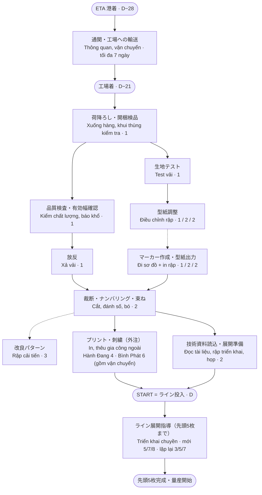

# Lead time sản xuất: từ ETA đến START / 生産工程リードタイム

Tài liệu dùng để thảo luận với TIJ về mốc giao nguyên phụ liệu.

| | ETA (về cảng HCM / 港着) | 工場着 (về nhà máy) |
|---|---|---|
| **Chuẩn cũ / 旧基準** | START − 21 ngày (3 tuần) | START − 14 ngày (2 tuần) |
| **Chuẩn mới / 新基準** | START − 28 ngày (4 tuần) | START − 21 ngày (3 tuần) |

- **START = ライン投入（準備完了）**: ngày đưa mã vào chuyền khi đã chuẩn bị xong. Chuẩn cũ "2 tuần" trong cuộc họp là từ lúc phụ liệu về nhà máy đến ライン投入.
- Triển khai chuyền (hướng dẫn đến khi ra 5 pcs đầu) diễn ra **sau** START.
- Từ ETA đến 工場着: thông quan + vận chuyển, tối đa 7 ngày kể cả luồng đỏ.

## Flowchart / 業務フロー

Nét đứt: bắt đầu cùng lúc / làm song song. Số ngày theo 3 mức SAH: dưới 8.000 / 8.000–12.000 / trên 12.000 giây.

## Thời gian chuẩn (ngày làm việc)

Nguồn: file `data/nguon/Ra-soat-thoi-gian-can-de-vao-chuyen-20260722.xlsx`, cập nhật theo cuộc họp rà soát lead time.

| Bộ phận | Bước | < 8.000s | 8.000–12.000s | > 12.000s | Căn cứ |
|---|---|---|---|---|---|
| XNK & Vận chuyển | Thông quan, chuyển hàng về nhà máy (ngày lịch) | 7 | 7 | 7 | File rà soát |
| Bốc vác | Xuống hàng, khui thùng kiểm tra | 1 | 1 | 1 | Họp |
| Chất lượng kho | Kiểm chất lượng, xác nhận và báo khổ | 1 | 1 | 1 | Họp |
| Kỹ thuật | Test vải (co rút) | 1 | 1 | 1 | Họp: test + chỉnh rập 1–2 ngày |
| Phòng cắt | Xả vải | 1 | 1 | 1 | Họp |
| Phòng cắt | Nguyên liệu sẵn sàng trước khi cắt (tối thiểu) | 4 | 4 | 4 | Họp |
| Kỹ thuật | Điều chỉnh rập theo kết quả test | 1 | 2 | **2** | Họp: trên 12.000s rập + sơ đồ ≥ 3 ngày |
| Kỹ thuật | Đi sơ đồ + in rập (bắt đầu ngày thứ 2 của chỉnh rập) | 1 | 2 | **2** | Họp |
| Kỹ thuật | Rập cải tiến (song song với cắt) | 3 | 3 | 3 | File rà soát |
| Phòng cắt | Cắt, đánh số, bó | 2 | 2 | 2 | Họp |
| Gia công | In/thêu tại Hành Đang (2–3 ngày + vận chuyển) | 4 | 4 | 4 | Họp: cắt xong trước ライン投入 4 ngày |
| Gia công | In/thêu tại Bình Phát (4–5 ngày + vận chuyển) | 6 | 6 | 6 | Họp |
| Chuyền | Đọc tài liệu kỹ thuật, rập triển khai, họp (song song với gia công) | 2 | 2 | 2 | File rà soát, họp |
| Chuyền | Triển khai sau START – mã mới | 5 | 7 | 8 | File rà soát, họp |
| Chuyền | Triển khai sau START – hàng lặp lại | 3 | 5 | 7 | File rà soát |

Thay đổi so với file Excel: in/thêu chuyển sang làm **sau** khi cắt xong (gửi gia công ngoài), mức trên 12.000s tăng rập + sơ đồ từ 1+1 lên 2+2 (tổng 3 ngày), mốc cuối đổi từ "ra 5 pcs đầu" sang ライン投入.

## Số ngày cần từ 工場着 đến START (ライン投入)

Ngày lịch, nghỉ Chủ nhật, lấy trường hợp lâu nhất trong tuần. Cột dư/thiếu: so với chuẩn cũ 14 / chuẩn mới 21.

| SAH | Không in/thêu | In/thêu Hành Đang | In/thêu Bình Phát |
|---|---|---|---|
| < 8.000s | 10 (+4 / +11) | 12 (+2 / +9) | 15 (**−1** / +6) |
| 8.000–12.000s | 11 (+3 / +10) | 13 (+1 / +8) | 16 (**−2** / +5) |
| > 12.000s | 11 (+3 / +10) | 13 (+1 / +8) | 16 (**−2** / +5) |

Kết luận:
- Cần 10–16 ngày cho 1 mã khi đủ người.
- Chuẩn cũ 14 ngày đáp ứng 6/9 trường hợp, dự phòng ít nhất 1 ngày; mã gia công Bình Phát thiếu tới 2 ngày. Điều này khớp với nhận định trong họp: mã dưới 8.000 giây làm được 14 ngày nếu chuẩn bị kỹ, mã phức tạp cần điều chỉnh riêng.
- Chuẩn mới 21 ngày cho mọi trường hợp dự phòng ít nhất 5 ngày, đủ để hấp thụ ETA trễ, vải lỗi, thiếu hàng và thời gian chờ khi nhiều mã chạy song song với số kỹ thuật hiện có.
- Yêu cầu triển khai trong 10–12 ngày chỉ làm được ở 4/9 trường hợp (không in/thêu hoặc Hành Đang, độ khó thấp), không còn dự phòng.

## Lý do thay đổi chuẩn / 基準変更の理由

1. **Số chuyền tăng, thiếu kỹ thuật / ライン数の増加・人員不足**: nhiều mã chuẩn bị cùng lúc; kỹ thuật rập và kỹ thuật triển khai thiếu người, tải dồn vào một số người.
2. **Độ khó tăng / 難易度の上昇**: mã trên 12.000 giây cần tối thiểu 3 ngày cho rập + sơ đồ; mỗi kỹ thuật triển khai được 1.000–1.200 giây/ngày, mã 12.000–15.000 giây mất 7–8 ngày.
3. **Hàng lô nhỏ, gia công ngoài / 小ロット化・外注加工**: nhiều mã hơn trên cùng sản lượng; in/thêu tại Bình Phát làm khoảng cách từ cắt đến vào chuyền lên 6 ngày.
4. **Chuyển đổi mã nhiều / 品番切替の増加**: mỗi lần chuyển đổi phải đọc tài liệu, làm rập triển khai, họp; vào chuyền khi chưa chuẩn bị đủ thì thời gian tìm hiểu tại chuyền kéo dài, hiệu suất giảm.

## Việc cần làm sau cuộc họp

| Phụ trách | Nội dung |
|---|---|
| Quyền | Kiểm tra lại số ngày triển khai chuyền tại nhà máy Quảng Ngãi cho mã tương đương (khoảng 8.000 giây) và báo cáo. |
| Kỹ thuật (Speaker 1) | Xây dựng cách làm để đọc tài liệu kỹ thuật, chuẩn bị xong trước ngày vào chuyền 2 ngày. |
| Chưa ghi rõ (Kỹ thuật) | Tổng hợp số người và vị trí cần tăng (kỹ thuật rập, kỹ thuật triển khai), đề nghị ban giám đốc tăng người; nhờ nhân sự xem xét tuyển mới hoặc điều chuyển từ bộ phận khác. |
| Kho, logistics | Quản lý chính xác ETA nguyên liệu và chia sẻ với bộ phận kế hoạch. |

## Điểm còn mở

- Thời gian vận chuyển đi/về nơi gia công đang giả định 1 ngày (Hành Đang 3 + 1, Bình Phát 5 + 1). Cần xác nhận.
- Khi một mã vừa in vừa thêu, đang giả định làm cùng một nơi trong cùng khoảng thời gian.
- Số người cần ở các ô "?" trong file gốc chưa có câu trả lời rõ ràng.
- Kết quả đối chiếu số ngày triển khai tại Quảng Ngãi (việc của Quyền) có thể làm thay đổi số ngày triển khai sau START.
